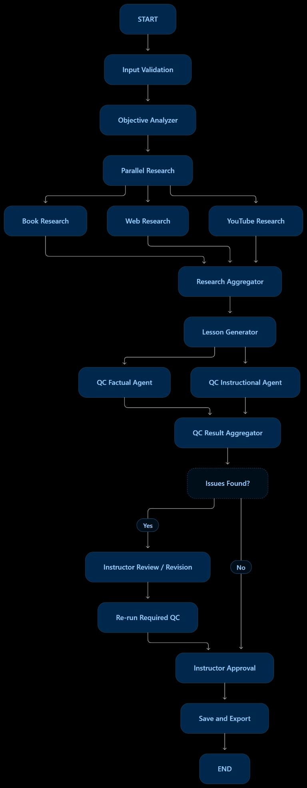

# AI Lesson Creator

AI Lesson Creator is a Streamlit application that researches a topic and generates a structured lesson plan with learning objectives, teaching content, assessments, references, and a downloadable PDF.

## Features

- Instructional-design workflow powered by LangGraph and Groq
- Web, book, and YouTube research through MCP tools
- Optional YouTube transcript research
- Accuracy and pedagogy review stages
- Markdown and PDF lesson export

## Architecture

The workflow validates the lesson request, analyzes objectives, performs parallel research, aggregates the findings, generates the lesson, runs factual and instructional-quality checks, and exports the approved result.



## Setup

1. Create and activate a Python virtual environment.
2. Install dependencies:

   ```powershell
   pip install -r requirements.txt
   ```

3. Copy `.env.example` to `.env` and add your API keys.
4. Start the application:

   ```powershell
   streamlit run app.py
   ```

Never commit `.env` or any API keys. The repository includes `.env.example` for configuration reference.

## Tests

Run the test suite with:

```powershell
python -m pytest
```
